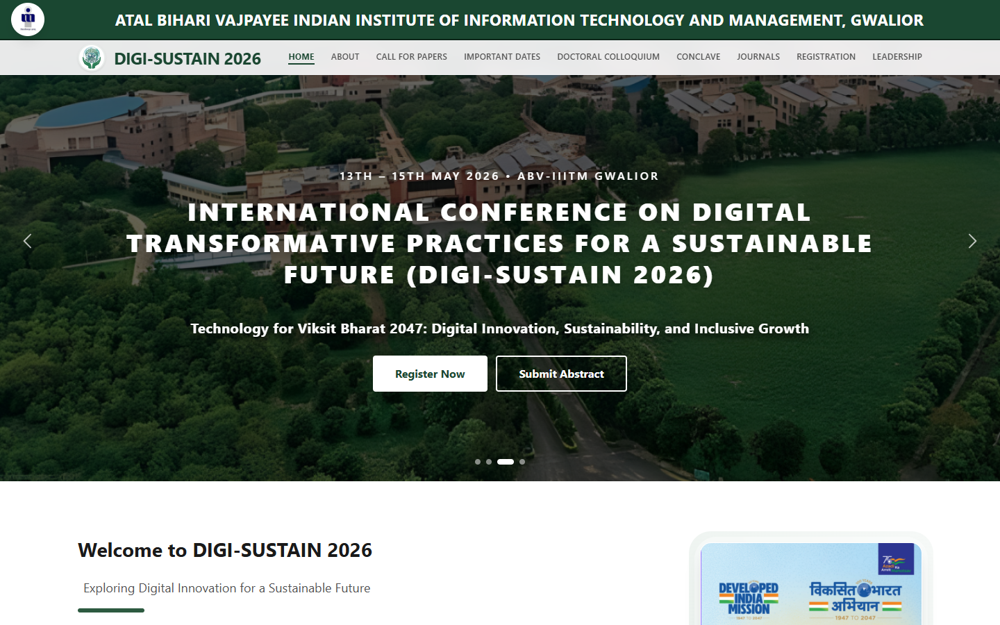

<h1 align="center">Hi, I'm Neerav Mishra 👋</h1>

  

  
  
  

---

### About me

- 🎓 Student at **ABV-IIITM Gwalior**
- 🧠 I build **machine-learning systems**: AI agents that verify their answers, recommender evaluation on 26M real logs, satellite mapping of Himalayan glacial lakes
- 🛠️ I ship **full-stack products** with Next.js, React, Node.js, FastAPI and PostgreSQL
- 📏 Every project comes with tests and reproducible results, not just a demo
- 📫 Reach me at **itsnjstyle27@gmail.com**

---

## 🤖 AI and machine learning

<table>
<tr>
<td width="45%" valign="top"></td>
<td valign="top">

### [Darkrai](https://github.com/itsnjstyle27/darkrai)
**An AI agent that verifies every answer.** It breaks a goal into a task graph, picks a tool for each
step with a contextual-bandit policy that learns from experience, and has an independent evaluator
check every result. Runs fully offline on its own fine-tuned 22M-parameter language model.

- Tool-choice accuracy on held-out tasks: **89.7% → 100%** after training
- False "verified" answers on blind prompts: **24.4% → 2.4%**

`Python` `PyTorch` `Transformers` `FastAPI` `React` `TypeScript`

</td>
</tr>
<tr>
<td width="45%" valign="top"></td>
<td valign="top">

### [counterfact](https://github.com/itsnjstyle27/counterfact)
**Off-policy evaluation, built from scratch and tested on 26.9M real recommendation logs.**
Seven estimators (IPW, DR, Switch-DR and more), a PyTorch reward model with cross-fitting, and the
full Open Bandit benchmark. The 11.7 GB dataset streams into a 753 MB in-memory format (15× smaller).

- Giving the reward model item identity cuts the direct-method error from **15.0% → 6.7%**

`Python` `PyTorch` `NumPy` `pytest`

</td>
</tr>
<tr>
<td width="45%" valign="top"></td>
<td valign="top">

### [Moraine](https://github.com/itsnjstyle27/moraine)
**Satellite screening of Himalayan glacial lakes.** Maps every lake each autumn since 1988 from
Landsat and Sentinel-2, scores outburst hazard and simulates the flood downstream. A replay of the
2023 South Lhonak disaster uses only data from before the event.

- **599 lakes** mapped; South Lhonak ranked **3rd of 570** before it burst
- Water classifier: **0.86 F1** on an independent inventory it never trained on

`Python` `LightGBM` `Remote sensing` `React` `MapLibre`

</td>
</tr>
</table>

## 🌐 Full-stack products

<table>
<tr>
<td width="45%" valign="top"></td>
<td valign="top">

### [LoomCart](https://github.com/itsnjstyle27/loomcart)
**A production-style fashion store that learns each shopper's taste.** Catalogue, Razorpay checkout,
back office, and a recommender that explains every pick. A/B analytics with significance tests measure
whether personalisation beats plain popularity.

- **132 automated tests**: 79 unit, 31 integration, 22 end-to-end

`Next.js 16` `TypeScript` `PostgreSQL` `Prisma` `Redis` `Docker`

</td>
</tr>
<tr>
<td width="45%" valign="top"></td>
<td valign="top">

### [HealthSync](https://github.com/itsnjstyle27/HealthSync)
**One place for a patient's medical records, under the patient's control.** Brings records from
different hospitals together, gives doctors and insurers temporary, scoped access via QR code or OTP,
and reads scanned reports offline with OCR to track follow-ups nobody should miss.

- **182 backend tests**; consent-aware AI assistant over the patient's own records

`React` `Node.js` `Express` `MongoDB` `Socket.IO` `Tesseract.js`

</td>
</tr>
</table>

## 🛠️ Developer tools

<table>
<tr>
<td width="45%" valign="top"></td>
<td valign="top">

### [patchwright](https://github.com/itsnjstyle27/patchwright)
**Finds open-source issues worth fixing, including cash bounties, and fixes them.** Works in a
sandboxed agent loop, proves each fix with tests, and writes a clean pull request. Nothing is pushed
until you approve it.

`Python` `Typer` `Anthropic SDK` `Gemini`

</td>
</tr>
</table>

## 🤝 Collaborations

<table>
<tr>
<td width="45%" valign="top"></td>
<td valign="top">

### [DIGI-SUSTAIN 2026](https://github.com/SK8-infi/digi-sustain-2026)
**Official website for ABV-IIITM's international conference** on digital transformation for a
sustainable future. Nine pages covering the call for papers, dates, registration and leadership, with
all conference content kept in data files so organisers can update it without touching the layout.

Built with [@aayuxsh326](https://github.com/aayuxsh326) and [@SK8-infi](https://github.com/SK8-infi) · [Live site](https://digi-sustain-2026.vercel.app)

`React` `Vite` `Tailwind CSS` `Vercel`

</td>
</tr>
</table>

---

## 🧰 Tech stack

**Languages** 

**Machine learning** 

**Backend and data** 

**Frontend** 

**Tooling** 

---

  <a href="https://www.linkedin.com/in/neerav-mishra-39a779323">LinkedIn</a> ·
  <a href="mailto:itsnjstyle27@gmail.com">Email</a> ·
  <a href="https://github.com/itsnjstyle27?tab=repositories">All repositories</a>

